## Hi there 👋

<div align="center">
  <picture>
    <source media="(prefers-color-scheme: dark)" srcset="./dark.svg">
    <source media="(prefers-color-scheme: light)" srcset="./light.svg">
    
  </picture>
</div>

<br/>

## ⚡ About & Engineering Focus

I am a third-year **Computer Science and Engineering (AI & ML)** undergraduate based in **Gurugram, Haryana, India**, focused on building autonomous AI agents, Retrieval-Augmented Generation (RAG) architectures, and full-stack **MERN** web applications.

I enjoy solving complex engineering problems by combining intelligent LLM/RAG backends with modern, responsive full-stack web interfaces.

- 🔭 **Currently working on:** Agentic RAG workflows, LangGraph orchestration pipelines, and full-stack MERN applications
- 🌱 **Currently exploring:** Multi-agent architectures, scalable Node/Express APIs, and modern state management
- 💻 **Core interests:** Artificial Intelligence, Autonomous Agents, Full-Stack MERN Engineering, and UI/UX Systems
- 🎯 **Engineering philosophy:** *First solve the problem, then write the code.*
- 📂 **Repositories:** [github.com/Sunil-raut?tab=repositories](https://github.com/Sunil-raut?tab=repositories)

<!-- 🌐 Portfolio: add your URL here when it is live -->

---

## 🛠️ Engineering Stack

<div align="center">
  
</div>

<br/>

| Domain | Technologies & Tools |
| :--- | :--- |
| **MERN Full-Stack** | MongoDB, Express.js, React.js, Node.js, JavaScript (ES6+), RESTful APIs, Dynamic State Management |
| **AI & Machine Learning** | Python, Retrieval-Augmented Generation (RAG), Agentic Workflows, LangChain, LangGraph, LLM APIs, FAISS, ChromaDB|
| **Frontend & UI/UX** | Component Architecture, Responsive Web Design, Dark/Light Theme Systems, Figma Prototyping |
| **Databases & Tooling** | MongoDB Atlas, Mongoose, Vector Databases (FAISS, ChromaDB), Git, GitHub, npm, Linux/macOS Shell |

---

<!--
## 🚀 Featured Projects
Add this section when you are ready. Suggested format:

| Project | What it does | Stack |
| :--- | :--- | :--- |
| [Director_AI](https://github.com/Sunil-raut/Director_AI) | Local AI-powered video editor on Apple Silicon (MLX): natural language editing, transcription, smart cuts and captions | Python, MLX |
-->

## 📊 GitHub Activity

<div align="center">
  
  
</div>

<div align="center">
  
</div>

---

## 🤝 Let's Connect

I am always open to discussing AI agent architectures, MERN full-stack development, and software engineering opportunities.

<p align="left">
  <a href="https://www.linkedin.com/in/sunil-rout-738546312" target="_blank">
    
  </a>
  <a href="mailto:sunilrout547@gmail.com">
    
  </a>
  <a href="https://github.com/Sunil-raut" target="_blank">
    
  </a>
</p>

---

## 💡 A Developer's Mindset

```javascript
while (!problem.isSolved()) {
  analyzeProblem();
  designArchitecture();
  writeCleanCode();
  testAndImprove();
}
```
